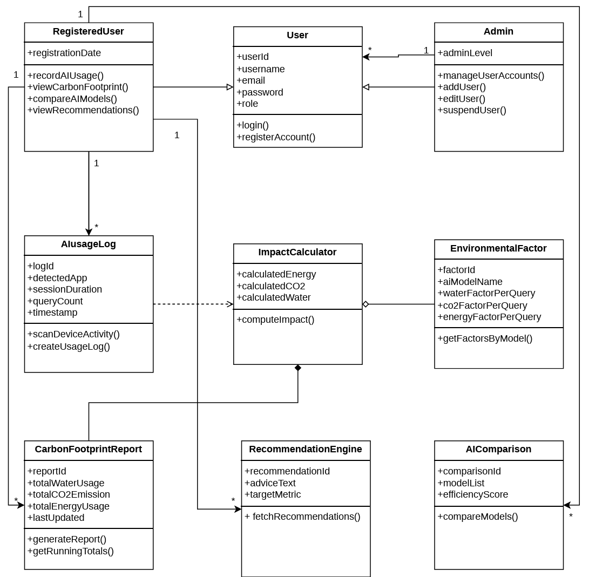

# **OxyGenAI**
## **Junior Project DTETI UGM | Group 2**

## Project Description
OxyGenAI is designed to track the environmental impact of generative AI usage. By analyzing token consumption and computational processes, the system estimates the corresponding carbon dioxide (CO2) emissions and water usage for each interaction.

## Group Member
- Group Leader: Deva Zukananda - 24/546873/TK/60780 
- Member 1 : Ursula Maurentti Amarely - 24/533008/TK/59050
- Member 2 : Satrio Suryo Anggoro Azis -24/536769/TK/59571
- Member 3 : Nabil Abrian Aryo Prabowo - 24/546496/TK/60770

---

## Tech Stack
This project is built using a pure **.NET ecosystem** to ensure a unified and maintainable architecture:

| Component | Technology |
| :--- | :--- |
| **Framework** | ASP.NET Core 10.0 (Blazor Web App) |
| **Language** | C# |
| **Database** | PostgreSQL + Entity Framework Core (Npgsql) |
| **Authentication** | ASP.NET Core Identity (Role-based: User & Admin) |
| **AI Integration** | Google.GenAI SDK (.NET) |
| **Proxy** | YARP (Yet Another Reverse Proxy) |
| **Frontend UI** | Blazor Components + Bootstrap |

---

## Key Features

### 1. Dynamic Token Tracking
- Integrates directly with the **Google Gemini API** to retrieve real-time usage metadata (`promptTokenCount`, `candidatesTokenCount`).
- Stores manually entered usage estimates in PostgreSQL.

### 2. Environmental Impact Calculator
- Uses a **token-weighted approximation** based on Google's published median-prompt estimates (May 2025).
- Calculates three core metrics:
  - **Energy Consumption** (Wh)
  - **Carbon Emissions** (gCO₂e)
  - **Water Consumption** (mL)

### 3. User Dashboard
- Visualizes daily, weekly, and monthly environmental trends.
- Provides personalized recommendations to reduce AI-related carbon footprints.

### 4. Admin Panel
- Role-based access control for administrators.
- Platform-wide aggregation of total tokens and environmental impact.
- User management (Add, Edit, Suspend).

---

## Project Architecture

The application follows a **modular monolithic** layered architecture:

```text
AIEnvironmentalTracker.Web/
├── Components/          # Blazor UI (Pages, Layouts, Dashboard)
├── Data/                # EF Core DbContext & Migrations
├── Models/              # Database Entities (AIUsageLog, EnvironmentalFactor)
├── Services/            # Business Logic
│   ├── GeminiService.cs           # API Communication
│   ├── ImpactCalculator.cs        # Environmental Estimation Logic
│   └── UsageTrackingService.cs    # Data Persistence
└── Program.cs           # Entry point & Dependency Injection
```

---

## Class Diagram


## Homework 8: PostgreSQL and OOP

The usage tracker on the home page demonstrates **encapsulation**. `EnvironmentalFactor` validates and holds per-query factors; `ImpactCalculator.ComputeImpact` calculates totals from a usage log and those factors; `UsageTrackingService.RecordAsync` saves the result in PostgreSQL for the signed-in user. The values entered in the form are user-provided estimates, not measurements from an AI provider. The existing `ai_usage_logs` and `chat_logs` tables are left intact.

### Run locally

1. Install .NET 10 and PostgreSQL. Create the `ai_environmental_db` database if it does not exist.
2. Set the connection string outside source control. For the local PostgreSQL settings supplied with this assignment:

   ```powershell
   dotnet user-secrets set 'ConnectionStrings:DefaultConnection' 'Host=localhost;Port=5432;Database=ai_environmental_db;Username=postgres;Password=YOUR_POSTGRES_PASSWORD;SSL Mode=Prefer;Timeout=30;Command Timeout=30' --project src/AIEnvironmentalTracker.Web/AIEnvironmentalTracker.Web.csproj
   ```

   Alternatively set `ConnectionStrings__DefaultConnection` in the process environment. Change the username and password for other machines.
3. Apply the PostgreSQL migration, then run the app:

   ```powershell
   dotnet ef database update --project src/AIEnvironmentalTracker.Web/AIEnvironmentalTracker.Web.csproj --startup-project src/AIEnvironmentalTracker.Web/AIEnvironmentalTracker.Web.csproj
   $env:ASPNETCORE_ENVIRONMENT = 'Development'
   $env:ASPNETCORE_URLS = 'http://localhost:5000'
   dotnet run --no-launch-profile --project src/AIEnvironmentalTracker.Web/AIEnvironmentalTracker.Web.csproj
   ```

4. Open `http://localhost:5000`, register, use the confirmation link shown on the registration confirmation page, and sign in. Enter a model name, query count, and per-query estimates. The recent records table reads the saved data from PostgreSQL.

The Gemini, OpenAI, DeepSeek, and Groq placeholder API keys are not needed for this worksheet's manual logging flow. They do not enable provider calls.
