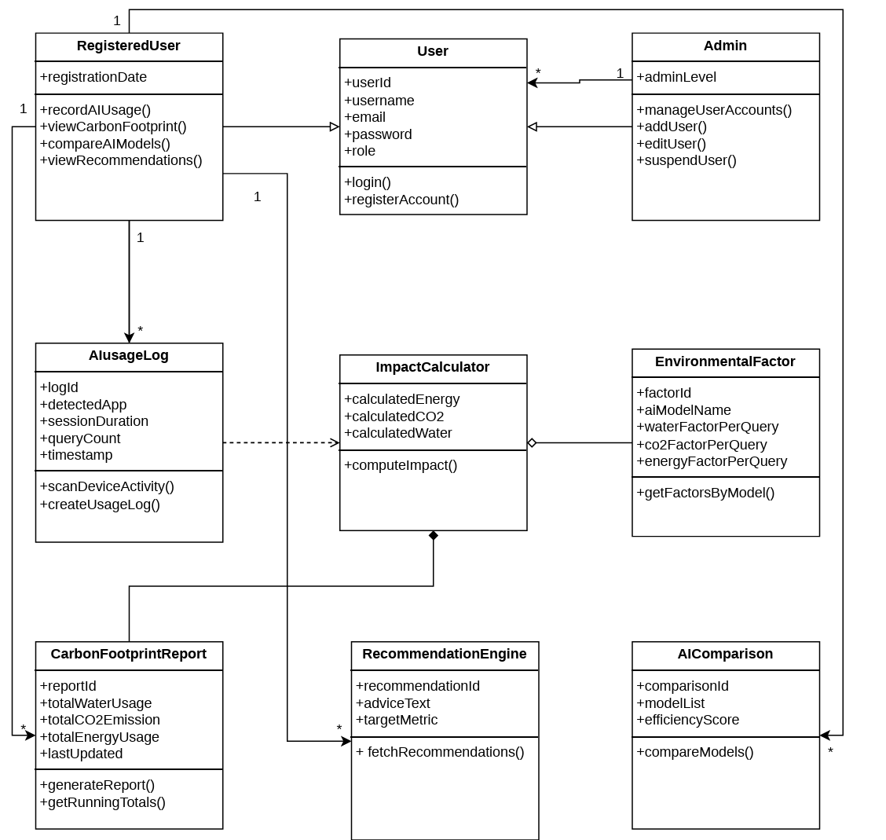

# **OxyGenAI**
## **Junior Project DTETI UGM | Group 2**

## Project Description
OxyGenAI is designed to track the environmental impact of generative AI usage. By analyzing token consumption and computational processes, the system estimates the corresponding carbon dioxide (CO2) emissions and water usage for each interaction.

## Group Member
- Group Leader: Deva Zukananda - 24/546873/TK/60780 
- Member 1 : Ursula Maurentti Amarely - 24/533008/TK/59050
- Member 2 : Satrio Suryo Anggoro Azis -24/536769/TK/59571
- Member 3 : Nabil Abrian Aryo Prabowo - 24/546496/TK/60770

---

## Tech Stack
This project is built using a pure **.NET ecosystem** to ensure a unified and maintainable architecture:

| Component | Technology |
| :--- | :--- |
| **Framework** | ASP.NET Core 10.0 (Blazor Web App) |
| **Language** | C# |
| **Database** | PostgreSQL + Entity Framework Core (Npgsql) |
| **Authentication** | ASP.NET Core Identity (Role-based: User & Admin) |
| **AI Integration** | Google.GenAI SDK (.NET) |
| **Proxy** | YARP (Yet Another Reverse Proxy) |
| **Frontend UI** | Blazor Components + Bootstrap |

---

## Key Features

### 1. Dynamic Token Tracking
- Integrates directly with the **Google Gemini API** to retrieve real-time usage metadata (`promptTokenCount`, `candidatesTokenCount`).
- Stores manually entered usage estimates in PostgreSQL.

### 2. Environmental Impact Calculator
- Uses a **token-weighted approximation** based on Google's published median-prompt estimates (May 2025).
- Calculates three core metrics:
  - **Energy Consumption** (Wh)
  - **Carbon Emissions** (gCO₂e)
  - **Water Consumption** (mL)

### 3. User Dashboard
- Visualizes daily, weekly, and monthly environmental trends.
- Provides personalized recommendations to reduce AI-related carbon footprints.

### 4. Admin Panel
- Role-based access control for administrators.
- Platform-wide aggregation of total tokens and environmental impact.
- User management (Add, Edit, Suspend).

---

## Project Architecture

The application follows a **modular monolithic** layered architecture:

```text
AIEnvironmentalTracker.Web/
├── Components/          # Blazor UI (Pages, Layouts, Dashboard)
├── Data/                # EF Core DbContext & Migrations
├── Models/              # Database Entities (AIUsageLog, EnvironmentalFactor)
├── Services/            # Business Logic
│   ├── GeminiService.cs           # API Communication
│   ├── ImpactCalculator.cs        # Environmental Estimation Logic
│   └── UsageTrackingService.cs    # Data Persistence
└── Program.cs           # Entry point & Dependency Injection
```

---

## Class Diagram


## Homework 8: PostgreSQL and OOP

The usage tracker on the home page demonstrates **encapsulation**. `EnvironmentalFactor` validates and holds per-query factors; `ImpactCalculator.ComputeImpact` calculates totals from a usage log and those factors; `UsageTrackingService.RecordAsync` saves the result in PostgreSQL for the signed-in user. The values entered in the form are user-provided estimates, not measurements from an AI provider. The existing `ai_usage_logs` and `chat_logs` tables are left intact.

## Module 10: Minimum Viable Product

- **Usage tracker** (home page): manual records go through `EnvironmentalFactor` and `ImpactCalculator`. After saving, `RecommendationEngine` shows advice for that record. A summary shows your total queries, water (mL), CO₂ (g) and energy (Wh), held in a `CarbonFootprintReport`. Times are shown in your browser's time zone.
- **Ask Gemini** (signed-in users only): `GeminiService` calls the Gemini REST API (`generateContent`, default model `gemini-2.5-flash`) and reads `usageMetadata` from the reply. `TokenImpactEstimator` turns the total token count into an `EnvironmentalFactor`. It uses a token-weighted approximation of Google's published estimate for the median Gemini Apps text prompt (May 2025): 0.24 Wh, 0.03 gCO₂e and 0.26 mL water, assuming that median prompt is 500 tokens. The result is saved through `UsageTrackingService`. These figures are estimates, not measurements.
- Registration no longer needs email confirmation, and database migrations are applied automatically on startup.

### Run locally

1. Install the .NET 10 SDK and PostgreSQL. Create an empty database, for example `ai_environmental_db`. The app creates the tables itself the first time it starts.
2. Set the connection string and Gemini API key outside source control. Never put them in `appsettings.json`.

   ```powershell
   dotnet user-secrets set "ConnectionStrings:DefaultConnection" "Host=localhost;Port=5432;Database=ai_environmental_db;Username=postgres;Password=YOUR_POSTGRES_PASSWORD" --project src/AIEnvironmentalTracker.Web
   dotnet user-secrets set "Gemini:ApiKey" "YOUR_GEMINI_API_KEY" --project src/AIEnvironmentalTracker.Web
   ```

   User secrets are only loaded in the Development environment. In any other environment, set the environment variables `ConnectionStrings__DefaultConnection` and `Gemini__ApiKey` instead. You can get a Gemini key from Google AI Studio. To use a different model, set `Gemini__Model`.
3. Run the app:

   ```powershell
   dotnet run --project src/AIEnvironmentalTracker.Web --launch-profile http
   ```

4. Open `http://localhost:5260` and register; you are signed in right away. Use **Usage tracker** to enter manual estimates and **Ask Gemini** to send live prompts.

If the Gemini key is missing, the Ask Gemini page explains how to set it. Network errors, rejected keys and rate limits appear as messages, and the app keeps running.
