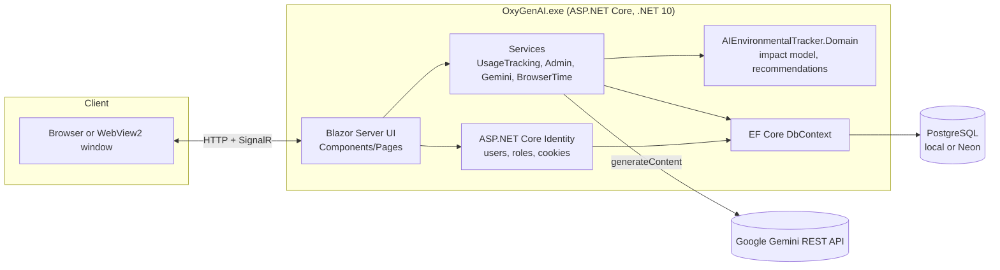
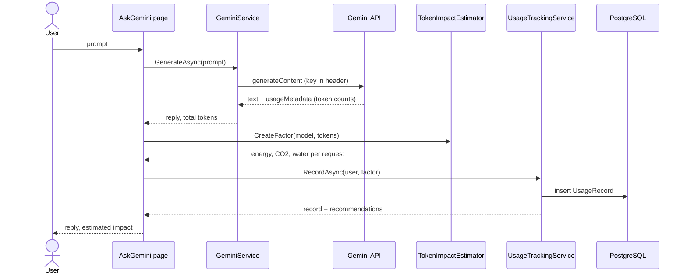

# OxyGenAI – Decisions and System Design

_Snapshot: 2026-11-25._

---

## 1. Context and requirements

- Estimate the environmental impact (energy, CO₂, water) of generative-AI usage per interaction.
- Course requirement: **C# codebase; the output is a Windows application**. Blazor is allowed.
- Roles: registered user (tracks own usage) and admin (manages accounts, sees platform totals).
- Constraints: small team, short deadline, free-tier services only.

## 2. Architecture



### Solution layout

| Path | Purpose |
| :--- | :--- |
| `src/AIEnvironmentalTracker.Domain` | Plain C# library: `EnvironmentalFactor`, `ImpactCalculator`, `CarbonFootprintReport`, `RecommendationEngine`, `TokenImpactEstimator`, plus UML-derived classes (`User`, `Admin`, `RegisteredUser`, `AIComparison`, `AIUsageLog`). |
| `src/AIEnvironmentalTracker.Web` | Blazor Server app: pages, services, Identity, EF Core, migrations. |
| `packaging/`, `publish.ps1` | Build of the self-contained Windows package and its setup scripts. |
| `w7junpro/` (separate branch) | Week-7 WinForms lab project; not part of the main app. |

### Web project

| Folder | Content |
| :--- | :--- |
| `Components/Pages` | `Home` (usage tracker), `Dashboard`, `AskGemini`, `Admin` |
| `Components/Account` | Identity pages (login, register, manage) from the template |
| `Components/Usage` | Reusable parts: summary card, recommendations, recent table |
| `Services` | `UsageTrackingService`, `AdminService`, `GeminiService`, `BrowserTimeService`, `UserMessages` |
| `Data` | `ApplicationDbContext`, `ApplicationUser`, `UsageRecord`, migrations |

## 3. Data model

| Table | Source | Key columns |
| :--- | :--- | :--- |
| `AspNetUsers` | Identity | `Id`, `Email`, `UserName`, `PasswordHash`, `LockoutEnd` (used for suspension) |
| `AspNetRoles`, `AspNetUserRoles` | Identity | the `Admin` role and its members |
| `UsageRecords` | App | `ApplicationUserId` (FK, cascade delete), `AiModelName`, `QueryCount`, per-query water/CO₂/energy, totals, `Timestamp` (UTC) |

Index: `(ApplicationUserId, Timestamp)` supports the user's recent list and trend queries.
Time stamps are stored in UTC and converted to the browser's time zone for display and for bucketing in the dashboard.

## 4. Main flows

### Ask Gemini



### Dashboard
`UsageTrackingService.GetTrendAsync` reads the user's records from the start of the window, converts times to the user's zone, and builds fixed-size buckets (14 days, 12 weeks starting Monday, 12 months), including empty buckets, plus a per-model breakdown.

### Admin
`AdminService` wraps `UserManager` and `RoleManager`. Suspension sets a lockout end of `DateTimeOffset.MaxValue` and rotates the security stamp. Guards: no self-suspension, no self-demotion, never remove or suspend the last active admin. The platform totals are aggregated from `UsageRecords`.

## 5. Impact estimation method

Implemented in `TokenImpactEstimator`; sources, equations and limitations are written at the top of that file.

```
E_total      = 0.24 Wh x (total tokens / 500)          reference prompt energy, scaled linearly
E_overhead   = E_total x (PUE - 1) / PUE               PUE = 1.09
CO2e (g)     = E_total/1000 x 94 g/kWh + 0.010 g x (tokens / 500)
Water (mL)   = (E_total - E_overhead) x 1.15 L/kWh
```

- Source: Google, "Measuring the environmental impact of delivering AI at Google Scale", arXiv:2508.15734.
- Group assumptions: the median prompt is 500 tokens (not published); energy scales linearly with total tokens.
- Main limitations: applies to Gemini Apps text prompts only; the same factor for every model; market-based emission factor (the location-based one is about 3.7 times higher); training, networking and end-user devices excluded; estimates, not measurements.

## 6. Configuration and secrets

| Setting | Where to set | Notes |
| :--- | :--- | :--- |
| `ConnectionStrings:DefaultConnection` | user-secrets, env `ConnectionStrings__DefaultConnection`, or `oxygenai.settings.json` | Required. Npgsql format, `SSL Mode=Require` for Neon. |
| `Gemini:ApiKey` | user-secrets, env `Gemini__ApiKey`, or settings file | Optional; Ask Gemini is off without it. |
| `Gemini:Model` | `appsettings.json` or env `Gemini__Model` | Default in the repository: `gemini-2.5-flash`. |
| `Admin:Email` | user-secrets, env `Admin__Email`, or settings file | The account with this email becomes an admin at startup and at registration. |
| `OpenBrowser` | settings file | Packaged app opens the browser after start. |

Secrets are never committed. `oxygenai.settings.json` is git-ignored.

---

## 7. Decision records

### ADR-001 – Blazor Server on .NET 10
- **Status:** accepted.
- **Context:** the team knows C#; a single codebase for UI and logic is fastest; the output must run on Windows.
- **Decision:** ASP.NET Core Blazor Server (interactive server rendering) with Bootstrap.
- **Consequences:** needs a persistent connection (SignalR), so it cannot run on serverless hosts; works well as a local self-contained program.

### ADR-002 – PostgreSQL (Neon) instead of SQLite
- **Status:** accepted.
- **Context:** the project template used SQLite (`app.db`). The group wanted a real server database and a shared development database.
- **Decision:** Npgsql + EF Core, migrations applied at startup, Neon for the shared dev database, local PostgreSQL for the packaged app.
- **Consequences:** a database must be running before the app starts; connection strings are kept outside the repository; the leftover `app.db` is obsolete.

### ADR-003 – ASP.NET Core Identity for authentication and roles
- **Status:** accepted.
- **Context:** two user models exist: Identity's `ApplicationUser` and the Domain's `User/Admin/RegisteredUser` (from the UML, plain-text password, not stored).
- **Decision:** Identity is the only source of accounts and roles (`Admin` role). The Domain user classes stay as design-level types and are never persisted.
- **Consequences:** password hashing, lockout and cookies come from the framework; the admin features were rebuilt on `UserManager`; the duplicate Domain classes should be marked design-only or removed.

### ADR-004 – Suspend accounts, do not delete
- **Status:** accepted.
- **Context:** the UML says an admin can add, edit and suspend users; usage history must survive.
- **Decision:** suspension uses Identity lockout; there is no delete in the admin UI.
- **Consequences:** history is preserved; a suspended user's open session can last up to the revalidation interval (30 minutes).

### ADR-005 – Hard-coded, cited impact factors (no third-party impact API)
- **Status:** accepted for the estimator; per-model table proposed.
- **Context:** the Gemini API returns token counts and metadata but no energy, carbon or water data. A public calculator site offers an API through a marketplace (100 free requests per month) but does not disclose how it derives per-model numbers.
- **Decision:** keep constants in our own code and database, with the source written next to each value; derive carbon and water from energy with Google's published chain. Planned: an `EnvironmentalFactor` table with a source column and per-tier model assumptions that are labelled as assumptions.
- **Consequences:** transparent and offline; numbers are only as good as the cited paper; model comparison stays blocked until the table exists.

### ADR-006 – Google's method rather than EcoLogits
- **Status:** accepted.
- **Context:** EcoLogits (CC BY-SA 4.0 docs, MPL-2.0 code) models energy from active parameters, which are not public for Gemini models.
- **Decision:** use Google's own accounting for Gemini, and revisit EcoLogits if open-weight models are added.
- **Consequences:** results apply to Gemini text prompts only.

### ADR-007 – Deliver as a Windows app by hosting the web app in a WinForms shell (proposed)
- **Status:** proposed; awaiting confirmation of the requirement and the work.
- **Context:** the requirement is a C# codebase with a Windows application as output; Blazor is allowed. Today the package is a console program that opens the default browser.
- **Options:** (A) keep the current package; (B) a WinForms or WPF window hosting the app in WebView2; (C) .NET MAUI Blazor Hybrid.
- **Decision:** B, because it reuses all Blazor code and gives a real window. C needs a larger rewrite of authentication and hosting.
- **Consequences:** a new small project; the process-scanning feature (`AIUsageLog`) also becomes meaningful there.

### ADR-008 – No Vercel deployment
- **Status:** accepted.
- **Context:** Vercel has no .NET runtime, and Blazor Server needs long-lived connections.
- **Decision:** distribute the Windows package. If a hosted demo is needed, use a Docker-capable host with the existing PostgreSQL database.
- **Consequences:** no public URL by default.

### ADR-009 – First admin through configuration
- **Status:** accepted for the MVP.
- **Decision:** `Admin:Email` names the first admin; the account is promoted at startup and at registration. Further admins are granted in the admin panel.
- **Consequences:** no manual database edit is needed; see the registration-order risk in the progress document.

---

## 8. Open questions

1. Does the lecturer accept the packaged exe (browser) or require a native window?
2. Which Gemini models should be offered, and which is the default?
3. Do we need the per-model factor table and model comparison before the demo?
4. Keep or remove the design-only Domain user classes?
