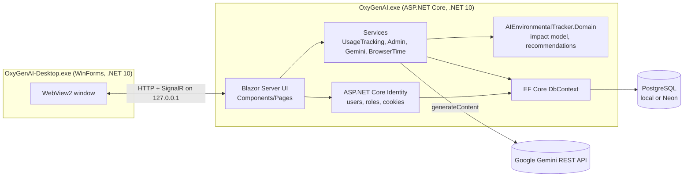
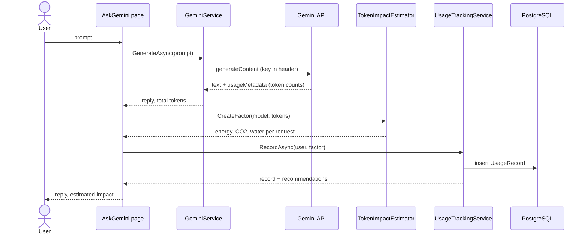

# OxyGenAI – Decisions and System Design

_Snapshot: 2026-11-25._

---

## 1. Context and requirements

- Estimate the environmental impact (energy, CO₂, water) of generative-AI usage per interaction.
- Course requirement: **C# codebase; the output is a Windows application**. Blazor is allowed. The final result is this Windows application; the app is not deployed to a web host.
- Roles: registered user (tracks own usage) and admin (manages accounts, sees platform totals).
- Constraints: small team, short deadline, free-tier services only.

## 2. Architecture



### Solution layout

| Path | Purpose |
| :--- | :--- |
| `src/AIEnvironmentalTracker.Domain` | Plain C# library: `EnvironmentalFactor`, `ImpactCalculator`, `CarbonFootprintReport`, `RecommendationEngine`, `TokenImpactEstimator`, plus UML-derived classes (`User`, `Admin`, `RegisteredUser`, `AIComparison`, `AIUsageLog`). |
| `src/AIEnvironmentalTracker.Web` | Blazor Server app: pages, services, Identity, EF Core, migrations. |
| `src/AIEnvironmentalTracker.Desktop` | The Windows app: a WinForms window with WebView2 that starts the Web app in the background (see section 3.1). |
| `packaging/`, `publish.ps1` | Build of the self-contained Windows package and its setup scripts. |
| `tests/AIEnvironmentalTracker.Tests` | xUnit tests on an in-memory database (no PostgreSQL needed). |
| `w7junpro/` (separate branch) | Week-7 WinForms lab project; not part of the main app. |

### Web project

| Folder | Content |
| :--- | :--- |
| `Components/Pages` | `Home` (usage tracker), `Dashboard`, `AskGemini`, `Compare`, `Admin` |
| `Components/Account` | Identity pages (login, register, manage) from the template |
| `Components/Usage` | Reusable parts: summary card, recommendations, recent table |
| `Services` | `UsageTrackingService`, `AdminService`, `GeminiService`, `AskLimiter`, `ModelComparisonService`, `BrowserTimeService`, `UserMessages` |
| `Data` | `ApplicationDbContext`, `ApplicationUser`, `UsageRecord`, migrations |

### Windows shell (`OxyGenAI-Desktop.exe`)

The shell does not contain any application logic. It starts the existing web app as a hidden process and displays it, so the Blazor code is the same whether it runs in a window or in a browser.

| Step | What happens |
| :--- | :--- |
| 1. Locate | `ServerLocator`: `OxyGenAI.exe` next to the shell (installed package), otherwise the newest build of the web project found by walking up from the shell (source tree, `Development` environment so that user-secrets work). `OXYGENAI_SERVER` can name another executable. |
| 2. Settings | Installed package without `oxygenai.settings.json` (and without the connection-string variable): the shell runs `Setup OxyGenAI.bat` once and waits. |
| 3. Start | `ServerProcess` picks a free loopback port and starts the server hidden with `--Kestrel:Endpoints:Http:Url=http://127.0.0.1:<port>` and `--OpenBrowser=false`. Command-line values win over the settings file, so the server listens only on that port and does not open a browser. |
| 4. Wait | It polls the address until any HTTP answer arrives (a redirect to the login page counts), for at most 90 seconds. If the server exits first, the last lines of its output (without stack frames) are shown in a message box. |
| 5. Show | WebView2 (Evergreen runtime, data folder in `%LOCALAPPDATA%\OxyGenAI\WebView2`) loads the address. The window title follows the page title. |
| 6. Contain | Only our own address (`127.0.0.1` or `localhost`, our port) may load in the window. Other http(s) links open in the default browser; other schemes are ignored. Developer tools are off. |
| 7. Stop | Closing the window ends the server. A Windows job object (kill on close) also ends it if the shell crashes, so no server is left holding the port. |

Diagnostic: `OxyGenAI-Desktop.exe --check <file>` runs steps 1 to 5 without user interaction, writes `OK|<page title>|<address>` or `FAIL|<reason>` to the file and exits with code 0 or 1.

Limits: it needs the WebView2 runtime (part of Windows 11); the package holds two self-contained programs (about 100 MB zipped); the shell does not bundle PostgreSQL.

## 3. Data model

| Table | Source | Key columns |
| :--- | :--- | :--- |
| `AspNetUsers` | Identity | `Id`, `Email`, `UserName`, `PasswordHash`, `LockoutEnd` (used for suspension) |
| `AspNetRoles`, `AspNetUserRoles` | Identity | the `Admin` role and its members |
| `UsageRecords` | App | `ApplicationUserId` (FK, cascade delete), `AiModelName`, `QueryCount`, per-query water/CO₂/energy, totals, `Timestamp` (UTC) |

Index: `(ApplicationUserId, Timestamp)` supports the user's recent list and trend queries.
Time stamps are stored in UTC and converted to the browser's time zone for display and for bucketing in the dashboard.

## 4. Main flows

### Ask Gemini



### Dashboard
`UsageTrackingService.GetTrendAsync` reads the user's records from the start of the window, converts times to the user's zone, and builds fixed-size buckets (14 days, 12 weeks starting Monday, 12 months), including empty buckets, plus a per-model breakdown.

### Admin
`AdminService` wraps `UserManager` and `RoleManager`. Suspension sets a lockout end of `DateTimeOffset.MaxValue` and rotates the security stamp. Guards: no self-suspension, no self-demotion, never remove or suspend the last active admin. The platform totals are aggregated from `UsageRecords`.

## 5. Impact estimation method

Implemented in `TokenImpactEstimator`; sources, equations and limitations are written at the top of that file.

```
E_total      = 0.24 Wh x (total tokens / 500)          reference prompt energy, scaled linearly
E_overhead   = E_total x (PUE - 1) / PUE               PUE = 1.09
CO2e (g)     = E_total/1000 x 94 g/kWh + 0.010 g x (tokens / 500)
Water (mL)   = (E_total - E_overhead) x 1.15 L/kWh
```

- Source: Google, "Measuring the environmental impact of delivering AI at Google Scale", arXiv:2508.15734.
- Group assumptions: the median prompt is 500 tokens (not published); energy scales linearly with total tokens.
- Main limitations: applies to Gemini Apps text prompts only; the same factor for every model; market-based emission factor (the location-based one is about 3.7 times higher); training, networking and end-user devices excluded; estimates, not measurements.

## 6. Configuration and secrets

| Setting | Where to set | Notes |
| :--- | :--- | :--- |
| `ConnectionStrings:DefaultConnection` | user-secrets, env `ConnectionStrings__DefaultConnection`, or `oxygenai.settings.json` | Required. Npgsql format, `SSL Mode=Require` for Neon. |
| `Gemini:ApiKey` | user-secrets, env `Gemini__ApiKey`, or settings file | Optional; Ask Gemini is off without it. |
| `Gemini:Model` | `appsettings.json` or env `Gemini__Model` | Default model; in the repository `gemini-3.5-flash-lite`. |
| `Gemini:AllowedModels` | `appsettings.json` | List of model ids a user may pick; the default is always allowed. |
| `Gemini:MaxPromptCharacters` | `appsettings.json` | Longest accepted prompt (4,000). |
| `AskLimits:DailyRequestsPerUser`, `AskLimits:MinSecondsBetweenRequests` | `appsettings.json` | Per-user allowance (30 per UTC day) and pause (3 s); 0 turns a limit off. |
| `Admin:Email` | user-secrets, env `Admin__Email`, or settings file | The account with this email becomes an admin at startup and at registration. |
| `OpenBrowser` | settings file | Packaged app opens the browser after start. |

Secrets are never committed. `oxygenai.settings.json` is git-ignored.

---

## 7. Decision records

### ADR-001 – Blazor Server on .NET 10
- **Status:** accepted.
- **Context:** the team knows C#; a single codebase for UI and logic is fastest; the output must run on Windows.
- **Decision:** ASP.NET Core Blazor Server (interactive server rendering) with Bootstrap.
- **Consequences:** needs a persistent connection (SignalR), so it cannot run on serverless hosts; works well as a local self-contained program.

### ADR-002 – PostgreSQL (Neon) instead of SQLite
- **Status:** accepted.
- **Context:** the project template used SQLite (`app.db`). The group wanted a real server database and a shared development database.
- **Decision:** Npgsql + EF Core, migrations applied at startup, Neon for the shared dev database, local PostgreSQL for the packaged app.
- **Consequences:** a database must be running before the app starts; connection strings are kept outside the repository; the leftover `app.db` is obsolete.

### ADR-003 – ASP.NET Core Identity for authentication and roles
- **Status:** accepted.
- **Context:** two user models exist: Identity's `ApplicationUser` and the Domain's `User/Admin/RegisteredUser` (from the UML, plain-text password, not stored).
- **Decision:** Identity is the only source of accounts and roles (`Admin` role). The Domain user classes stay as design-level types and are never persisted.
- **Consequences:** password hashing, lockout and cookies come from the framework; the admin features were rebuilt on `UserManager`; the duplicate Domain classes should be marked design-only or removed.

### ADR-004 – Suspend accounts, do not delete
- **Status:** accepted.
- **Context:** the UML says an admin can add, edit and suspend users; usage history must survive.
- **Decision:** suspension uses Identity lockout; there is no delete in the admin UI.
- **Consequences:** history is preserved; a suspended user's open session can last up to the revalidation interval (30 minutes).

### ADR-005 – Hard-coded, cited impact factors (no third-party impact API)
- **Status:** accepted for the estimator. The planned per-tier model assumptions were **dropped** (see below).
- **Context:** the Gemini API returns token counts and metadata but no energy, carbon or water data. A public calculator site offers an API through a marketplace (100 free requests per month) but does not disclose how it derives per-model numbers.
- **Decision:** keep constants in our own code, with the source written next to each value; derive carbon and water from energy with Google's published chain. Every Gemini model gets the **same energy per token**. We do not invent per-tier multipliers: a price tier is a commercial price per token and says nothing reliable about energy, and if anything a larger model needs more energy per token, not less. A per-model figure is added only when a published or measured source exists.
- **Consequences:** transparent and offline; numbers are only as good as the cited paper; models differ in the estimate only through the number of tokens they use for a prompt (including thinking tokens). The comparison page says so.

### ADR-006 – Google's method rather than EcoLogits
- **Status:** accepted.
- **Context:** EcoLogits (CC BY-SA 4.0 docs, MPL-2.0 code) models energy from active parameters, which are not public for Gemini models.
- **Decision:** use Google's own accounting for Gemini, and revisit EcoLogits if open-weight models are added.
- **Consequences:** results apply to Gemini text prompts only.

### ADR-007 – Deliver as a Windows app by hosting the web app in a WinForms shell
- **Status:** accepted and implemented (`src/AIEnvironmentalTracker.Desktop`). The lecturer has not been asked yet; the choice follows the stated requirement (C# basis, Windows application output, Blazor allowed).
- **Context:** the requirement is a C# codebase with a Windows application as output; Blazor is allowed. Today the package is a console program that opens the default browser.
- **Options:** (A) keep the current package; (B) a WinForms or WPF window hosting the app in WebView2; (C) .NET MAUI Blazor Hybrid.
- **Decision:** B, because it reuses all Blazor code and gives a real window. C needs a larger rewrite of authentication and hosting.
- **Implementation note:** the shell runs the server as a separate hidden process instead of hosting it inside its own process. That leaves the tested web project unchanged and keeps the browser-based start (`Start OxyGenAI.bat`) working. The price is two executables.
- **Consequences:** a new small project and a second program in the package; the process-scanning feature (`AIUsageLog`) can now be built into the shell later, where it makes sense.

### ADR-008 – No web deployment (Vercel or any other host)
- **Status:** accepted. The final result is the Windows application, so nothing is deployed.
- **Context:** Vercel has no .NET runtime, and Blazor Server needs long-lived connections.
- **Decision:** distribute the Windows package (zip). Hosting is not planned; should it ever be needed, a Docker-capable host with the existing PostgreSQL database would work, Vercel would not.
- **Consequences:** no public URL; users run the app on their own PC with their own PostgreSQL.

### ADR-009 – First admin through configuration
- **Status:** accepted for the MVP.
- **Decision:** `Admin:Email` names the first admin; the account is promoted at startup and at registration. Further admins are granted in the admin panel.
- **Consequences:** no manual database edit is needed; see the registration-order risk in the progress document.

---

### ADR-010 – Other LLM providers are future work
- **Status:** deferred.
- **Context:** several providers offer free tiers with an OpenAI-compatible API that also returns token counts (for example OpenRouter, Groq, a local Ollama). Free-tier limits change often and were not verified first-hand.
- **Decision:** keep Gemini as the only provider for now. When added, use one adapter for OpenAI-compatible APIs (base URL, key, model) behind a small provider interface. Open-weight models have public parameter counts, so EcoLogits' parameter-based method could then be used for them (revisit ADR-006).
- **Consequences:** no extra dependency or key now.

### ADR-011 – Gemini model allow-list and per-user limits
- **Status:** accepted.
- **Context:** one API key serves all users and the free tier is small; models can be unavailable (HTTP 503/404).
- **Decision:** `Gemini:AllowedModels` lists the ids a user may pick (default `gemini-3.5-flash-lite`; also `gemini-3.6-flash`, the two that answered a test call). `GeminiService` refuses any other id before calling Google. The prompt length is capped on the server (4,000 characters). `AskLimiter` gives each user a daily allowance (30 per UTC day) and a short pause between requests. The counters live in memory.
- **Consequences:** a user cannot select an arbitrary or paid model; counters reset when the app restarts and are not shared across instances (acceptable for one local instance; use a database table if the app is ever hosted on several).

### ADR-012 – Model comparison ranks by estimated impact of the tokens used
- **Status:** accepted.
- **Context:** the UML has `compareAIModels()`; there is no per-model energy data (ADR-005).
- **Decision:** `ModelComparisonService` sends the same prompt to the chosen models, estimates the impact of each answer from its total tokens, ranks by estimated CO₂ (the Domain class `AIComparison` supplies the efficiency score), and saves each answer as usage because each one is a real request. A failing model is listed with its error and does not stop the others.
- **Consequences:** the ranking shows which model needed fewer tokens for this prompt, which is a real and measurable difference, not a claim about energy per token.

## 8. Open questions

1. Confirm with the lecturer that a WinForms window hosting the Blazor app (WebView2) meets "C# basis, Windows application output".
2. Re-test the Gemini models that returned 503 and offer them when stable.
3. Is there a published or measured per-model energy source we can cite (needed before claiming differences per token)?
4. Keep or remove the design-only Domain user classes (`User`, `Admin`, `RegisteredUser`)? They are part of the UML and the worksheets, so they are kept for now.
